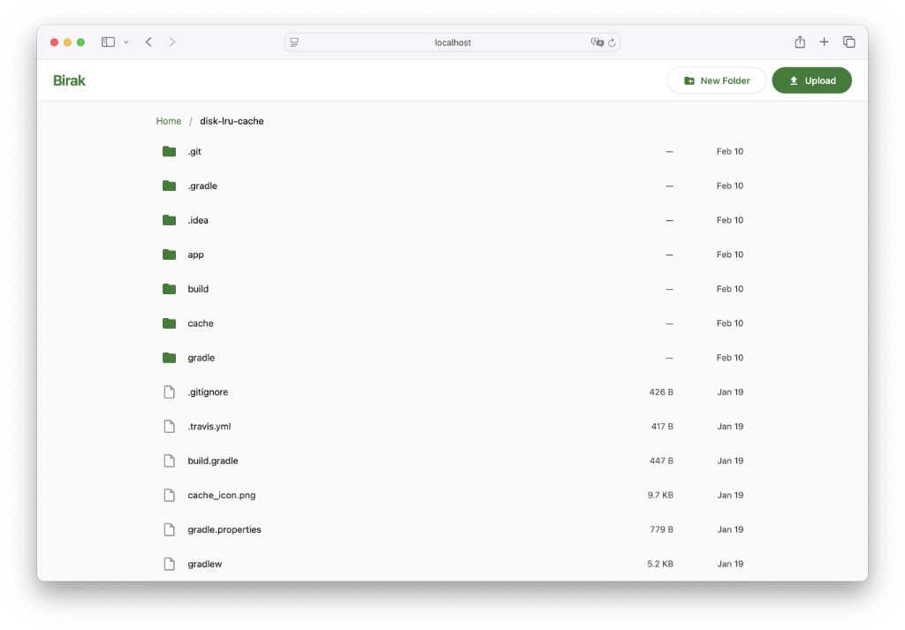

# Birak — Distributed File Server

Birak is a distributed file server with built-in replication. Each node stores a full copy of the data and automatically keeps it in sync with other nodes over the network. Files are accessible via S3 API, WebDAV, SFTP, HTTP file browser, or the local filesystem — use whichever protocol fits your workflow.

<p align="center">
  
</p>

## Key Features

- **Multi-protocol access** — S3 API, WebDAV, SFTP, HTTP file browser, or direct filesystem.
- **S3 multipart uploads** — crash-safe, resumable parallel uploads with TTL cleanup and per-part checksums.
- **Automatic replication** — nodes discover changes in real time and replicate them to all peers.
- **Recoverable replication** — durable repairs retain failed operations, periodic manifest reconciliation checks divergence, and checksum scans detect changes missed by filesystem events.
- **Conflict resolution** — a per-path logical clock with deterministic tie-breaks, shared by polling, repairs, and reconciliation.
- **No single point of failure** — every node is equal; any node can accept reads and writes.
- **Fails closed** — gateways refuse to start without credentials, peers require a cluster secret and can talk over TLS, and a node that would replicate a mass deletion it did not perform holds it back.
- **Zero external dependencies** — single Go binary, embedded SQLite for metadata.

## How It Works

A Birak cluster consists of one or more **nodes**. Each node has two directories:

- **sync_dir** — the directory where your files live. Any file you put here (or upload via S3/WebDAV/SFTP/browser) gets replicated to all other nodes.
- **meta_dir** — internal directory for the SQLite database that tracks file versions and sync state. You don't need to touch this.

Nodes know about each other through a **peers** list in the config. Each node polls its peers for changes and downloads new or updated files automatically. There is no central server — every node is a full replica.

Each node accepts local reads and writes independently of the number of reachable
peers. Nodes resume synchronization when connectivity returns; there is no leader,
voting membership, or minimum cluster size required to keep a healthy node working.
New nodes join replication by configuring peers. A restored consistent backup can
rejoin with its original metadata; unchanged indexed bytes retain their recorded
rank even if the backup tool lost their timestamps. See the recovery rules below.

Writes are acknowledged after local publication, before asynchronous replication
completes. An isolated node's successful response does not guarantee that another
node has the file. Concurrent changes converge using the conflict rules below.

Birak supports filesystem replication only. The former experimental quorum mode
and its private data layout are no longer supported. `storage_mode: filesystem`
is accepted for compatibility; another value fails startup. Quorum data directories
cannot be used as `sync_dir` or `meta_dir`; there is no automatic conversion.

Files can arrive through `cp`, `rsync`, an application, or S3/WebDAV/SFTP/browser. For direct filesystem updates, publish atomically and change the mtime when replacing bytes. An unexplained checksum change with identical size and mtime is quarantined and repaired from a healthy peer; use a gateway when intentionally preserving both attributes. Once synced, files are accessible through any supported protocol.

## Quick Start

Current release: **v2.1.2**. Read the [release notes](docs/releases/v2.1.2.md)
before upgrading an existing cluster. Coming from v2.0.x, read the
[v2.1.0 upgrade notes](docs/releases/v2.1.0.md) as well: v2.1.0 refuses
configurations that earlier releases accepted with only a warning.

### Docker

The fastest way to try Birak — no config file needed:

```bash
docker run -d \
  -e BIRAK_HTTP_ENABLED=true \
  -e BIRAK_HTTP_USERNAME=admin \
  -e BIRAK_HTTP_PASSWORD=choose-a-password \
  -v ./sync:/data/sync \
  -v ./meta:/data/meta \
  -p 127.0.0.1:9400:9400 \
  solkin/birak:2.1.2
```

Open `http://localhost:9400` and sign in — you'll see the file browser. Upload a file, and it will appear in the `./sync` directory on your host machine.

An enabled gateway needs both of its credentials; Birak refuses to start
otherwise. To serve a gateway without authentication on purpose, set its
`allow_anonymous: true` (`BIRAK_HTTP_ALLOW_ANONYMOUS=true` here).

For a production node use the repository's [`docker-compose.yml`](docker-compose.yml)
with an `.env` built from [`.env.example`](.env.example), and a reverse proxy from
[`deploy/`](deploy/): nginx for one node, HAProxy for several nodes behind one
address (it keeps a node out of rotation until `/readyz` answers).

### Docker Compose (2-node cluster)

To see replication in action, run two nodes:

```yaml
# docker-compose.yaml
x-common: &common
  BIRAK_CLUSTER_SECRET: "demo-cluster-secret"
  BIRAK_HTTP_ENABLED: "true"
  BIRAK_HTTP_USERNAME: "admin"
  BIRAK_HTTP_PASSWORD: "demo-password"

services:
  node1:
    image: solkin/birak:2.1.2
    environment:
      <<: *common
      BIRAK_NODE_ID: "node-1"
      BIRAK_PEERS: "http://node2:9100"
    volumes:
      - node1-sync:/data/sync
      - node1-meta:/data/meta
    ports:
      - "127.0.0.1:9101:9100"
      - "127.0.0.1:9401:9400"

  node2:
    image: solkin/birak:2.1.2
    environment:
      <<: *common
      BIRAK_NODE_ID: "node-2"
      BIRAK_PEERS: "http://node1:9100"
    volumes:
      - node2-sync:/data/sync
      - node2-meta:/data/meta
    ports:
      - "127.0.0.1:9102:9100"
      - "127.0.0.1:9402:9400"

volumes:
  node1-sync:
  node1-meta:
  node2-sync:
  node2-meta:
```

```bash
docker compose up -d
```

Open `http://localhost:9401` and `http://localhost:9402` (user `admin`) — upload a file on one node and watch it appear on the other.

Every node with peers needs its own `node_id` and the shared `cluster_secret`;
Birak refuses to start without them. The same peer list may be given to every
node: a URL that turns out to be the node itself is recognized and skipped.

### Build from Source

```bash
go build -o birakd ./cmd/birakd
./birakd -config config.yaml
```

The daemon will create `sync_dir` and `meta_dir` if they don't exist, open a SQLite database at `meta_dir/birak.db`, and start synchronizing.

To stop — send `SIGINT` or `SIGTERM` (Ctrl+C). Open transfers get 8 seconds to
finish, then the daemon exits; give a container runtime more than that before
it sends SIGKILL (`stop_grace_period: 30s` in compose). An interrupted upload is
never published, and a replica resumes an interrupted download. `birakd -version`
prints the release.

## Configuration

Birak can be configured via a YAML file, environment variables, or both. Environment variables take precedence over the config file. The config file itself is optional — you can run Birak entirely with env vars. When
`-config` is supplied, that file must exist and parse successfully. Non-empty
numeric, duration, and boolean environment overrides must be valid; malformed
values stop startup instead of silently selecting defaults. Boolean values are
`true`/`false`, `yes`/`no`, or `1`/`0` (case-insensitive). Component failures,
including occupied listen ports, stop the daemon with a nonzero exit code.

### YAML config file

```bash
./birakd -config config.yaml
```

**Minimal:**
```yaml
node_id: "node-1"
cluster_secret: "a-long-random-secret"
peers:
  - "http://192.168.1.2:9100"
```

**Full example:**
```yaml
node_id: "node-1"
sync_dir: "/data/sync"
meta_dir: "/data/meta"
listen_addr: ":9100"
log_level: "info"           # debug | info | warn | error
access_log: true            # one line per gateway request
tls_cert_file: "/tls/node.pem"     # serve the peer API over HTTPS (with tls_key_file)
tls_key_file: "/tls/node.key"
peer_ca_file: "/tls/cluster-ca.pem"  # extra CA for verifying https:// peers
metrics_token: "scrape-token"      # bearer token that opens /metrics only
peers:
  - "https://192.168.1.2:9100"
  - "https://192.168.1.3:9100"
ignore:
  - ".DS_Store"
  - "Thumbs.db"
  - "*.swp"
max_upload_bytes: 1073741824   # 1 GiB cap per upload; 0 = unlimited except HTTP UI (1 GiB default)
multipart:                    # S3 multipart upload limits and retention
  min_part_bytes: 5242880     # 5 MiB — minimum size of every part but the last
  max_part_bytes: 5368709120  # 5 GiB — maximum size of a single part
  max_parts: 10000            # highest accepted part number
  max_active_uploads: 10000   # simultaneously staged uploads; 0 = unlimited
  max_concurrent_part_uploads: 0  # in-flight part uploads; 0 = unlimited
  upload_ttl: 168h            # discard an untouched incomplete upload after this
  cleanup_interval: 1h        # how often the janitor sweeps
  temp_file_max_age: 24h      # age at which an orphaned scratch file is removed
cluster_secret: "shared-secret"  # required on every peer-to-peer request; mandatory with peers
sync:
  poll_interval: 3s
  batch_limit: 1000
  max_concurrent_downloads: 5
  tombstone_ttl: 168h       # legacy setting; automatic tombstone GC is disabled
  scan_interval: 5m           # stat-only sweep; no longer re-reads file bytes
  scrub_bytes_per_second: 8388608  # continuous checksum verification budget; 0 disables
  max_repair_queue: 100000    # queued entries per peer; 0 = unlimited
  max_external_deletions: 1000  # deletions found on disk per 10 min before they are held; 0 = no limit
  reconcile_page_budget: 64   # manifest pages per pass; 0 = the whole manifest at once
  debounce_window: 300ms
  repair_interval: 30s      # how often failed changes are retried
  reconcile_interval: 1h    # full manifest comparison with every peer
gateways:
  s3:
    enabled: true
    listen_addr: ":9200"
    access_key: "admin"
    secret_key: "secret123"
    # allow_anonymous: true    # the only way to run an enabled gateway without credentials
    buckets: ["backups"]       # created at startup when missing
  webdav:
    enabled: true
    listen_addr: ":9300"
    username: "user"
    password: "secret123"
  http:
    enabled: true
    listen_addr: ":9400"
    username: "user"
    password: "secret123"
  sftp:
    enabled: true
    listen_addr: ":9500"
    username: "user"
    password: "secret123"
```

The `ignore`, `multipart`, and `sync` sections are optional — defaults will be used if omitted.

Startup fails closed on settings that would expose data or split a cluster:

- An enabled gateway needs both credentials (`access_key`/`secret_key`,
  `username`/`password`). With neither, it starts only with
  `allow_anonymous: true`; one credential alone is always an error, because an
  empty secret or password is a value anyone can use.
- Credentials and secrets that still start with `changeme` (the values in
  `.env.example`) are rejected.
- With `peers` configured, `node_id` and `cluster_secret` are required. A node
  without peers keeps the default `node_id: node-1`.
- Peer URLs must be `http://` or `https://` URLs with a host; empty items, such
  as a trailing comma in `BIRAK_PEERS`, are dropped.

Startup warnings remain for allowed but exposed setups: an anonymous gateway, an
empty `cluster_secret` on a non-loopback `listen_addr`, and `http://` peers whose
host is not on a private network. Internal state (`.birak/`) and scratch files (`.birak-tmp-*`, `.birak-bak-*`) are always ignored regardless of configuration. Ignore rules only exclude files from replication; directory cleanup never deletes their contents. A directory containing ignored files is retained.

### Environment variables

Every setting has a corresponding `BIRAK_*` environment variable. Useful for Docker and CI/CD. List values (peers, ignore, S3 buckets) are comma-separated.

```bash
export BIRAK_NODE_ID="node-1"
export BIRAK_CLUSTER_SECRET="a-long-random-secret"
export BIRAK_PEERS="http://192.168.1.2:9100,http://192.168.1.3:9100"
export BIRAK_HTTP_ENABLED=true
export BIRAK_HTTP_USERNAME=admin
export BIRAK_HTTP_PASSWORD=choose-a-password
./birakd
```

### Reference

| YAML | Env var | Default | Description |
|------|---------|---------|-------------|
| `storage_mode` | `BIRAK_STORAGE_MODE` | `filesystem` | Only `filesystem` is supported; another value fails startup |
| `node_id` | `BIRAK_NODE_ID` | `node-1` | Unique node ID; required when `peers` is set |
| `sync_dir` | `BIRAK_SYNC_DIR` | `./sync` | Directory to synchronize |
| `meta_dir` | `BIRAK_META_DIR` | `./meta` | Directory for SQLite database |
| `listen_addr` | `BIRAK_LISTEN_ADDR` | `:9100` | Peer-to-peer HTTP server address |
| `peers` | `BIRAK_PEERS` | `[]` | Peer `http(s)://` URLs (comma-separated in env) |
| `ignore` | `BIRAK_IGNORE` | `[]` | Ignore patterns (comma-separated in env) |
| `cluster_secret` | `BIRAK_CLUSTER_SECRET` | _(empty)_ | Shared secret required on peer-to-peer requests; mandatory with `peers`; empty leaves a standalone node's sync API open |
| `tls_cert_file` | `BIRAK_TLS_CERT_FILE` | _(empty)_ | PEM certificate chain for serving the peer API over HTTPS; configure with the key |
| `tls_key_file` | `BIRAK_TLS_KEY_FILE` | _(empty)_ | PEM private key for the peer API |
| `peer_ca_file` | `BIRAK_PEER_CA_FILE` | _(empty)_ | PEM bundle added to the system roots for verifying `https://` peers |
| `metrics_token` | `BIRAK_METRICS_TOKEN` | _(empty)_ | Bearer token accepted by `/metrics` in addition to the cluster secret |
| `log_level` | `BIRAK_LOG_LEVEL` | `info` | `debug`, `info`, `warn` or `error` |
| `access_log` | `BIRAK_ACCESS_LOG` | `true` | One info line per gateway request; request counters are kept either way |
| `max_upload_bytes` | `BIRAK_MAX_UPLOAD_BYTES` | `0` | Max upload bytes; 0 = unlimited for S3/WebDAV/SFTP, 1 GiB default for HTTP UI |
| `multipart.min_part_bytes` | `BIRAK_MULTIPART_MIN_PART_BYTES` | `5242880` | Minimum size of every multipart part but the last |
| `multipart.max_part_bytes` | `BIRAK_MULTIPART_MAX_PART_BYTES` | `5368709120` | Maximum size of a single multipart part |
| `multipart.max_parts` | `BIRAK_MULTIPART_MAX_PARTS` | `10000` | Highest accepted part number |
| `multipart.max_active_uploads` | `BIRAK_MULTIPART_MAX_ACTIVE_UPLOADS` | `10000` | Simultaneously staged uploads; 0 = unlimited |
| `multipart.max_concurrent_part_uploads` | `BIRAK_MULTIPART_MAX_CONCURRENT_PART_UPLOADS` | `0` | In-flight part uploads; 0 = unlimited |
| `multipart.upload_ttl` | `BIRAK_MULTIPART_UPLOAD_TTL` | `168h` | Retention for untouched incomplete uploads |
| `multipart.cleanup_interval` | `BIRAK_MULTIPART_CLEANUP_INTERVAL` | `1h` | Janitor sweep interval |
| `multipart.temp_file_max_age` | `BIRAK_MULTIPART_TEMP_FILE_MAX_AGE` | `24h` | Age for orphaned atomic-write scratch cleanup |
| `sync.poll_interval` | `BIRAK_SYNC_POLL_INTERVAL` | `3s` | Peer polling interval |
| `sync.batch_limit` | `BIRAK_SYNC_BATCH_LIMIT` | `1000` | Max entries per sync request |
| `sync.max_concurrent_downloads` | `BIRAK_SYNC_MAX_CONCURRENT_DOWNLOADS` | `5` | Active repair operations and downloads per peer, in each of two lanes: files of 8 MiB and more, and everything else |
| `sync.tombstone_ttl` | `BIRAK_SYNC_TOMBSTONE_TTL` | `168h` | Legacy compatibility setting; tombstones are retained indefinitely |
| `sync.scan_interval` | `BIRAK_SYNC_SCAN_INTERVAL` | `5m` | Stat-only sweep interval; indexes anything whose size or timestamp moved |
| `sync.scrub_bytes_per_second` | `BIRAK_SYNC_SCRUB_BYTES_PER_SECOND` | `8388608` | Continuous checksum verification budget; 0 disables verification |
| `sync.max_repair_queue` | `BIRAK_SYNC_MAX_REPAIR_QUEUE` | `100000` | Queued repair entries per peer; 0 = unlimited |
| `sync.max_external_deletions` | `BIRAK_SYNC_MAX_EXTERNAL_DELETIONS` | `1000` | Deletions found on disk (not made through Birak) published per 10 minutes; a larger group is held and the node turns unready. 0 = no limit |
| `sync.reconcile_page_budget` | `BIRAK_SYNC_RECONCILE_PAGE_BUDGET` | `64` | Manifest pages per comparison pass; 0 compares the whole manifest at once |
| `sync.debounce_window` | `BIRAK_SYNC_DEBOUNCE_WINDOW` | `300ms` | Delay before processing file events |
| `sync.repair_interval` | `BIRAK_SYNC_REPAIR_INTERVAL` | `30s` | Rescan interval for new or due repairs; free workers also refill on completion |
| `sync.reconcile_interval` | `BIRAK_SYNC_RECONCILE_INTERVAL` | `1h` | Full manifest comparison interval (0 disables — not recommended) |
| `gateways.s3.enabled` | `BIRAK_S3_ENABLED` | `false` | Enable S3 Gateway |
| `gateways.s3.listen_addr` | `BIRAK_S3_LISTEN_ADDR` | `:9200` | S3 Gateway address |
| `gateways.s3.access_key` | `BIRAK_S3_ACCESS_KEY` | _(empty)_ | S3 access key |
| `gateways.s3.secret_key` | `BIRAK_S3_SECRET_KEY` | _(empty)_ | S3 secret key |
| `gateways.s3.allow_anonymous` | `BIRAK_S3_ALLOW_ANONYMOUS` | `false` | Serve without credentials; required to enable S3 with neither key |
| `gateways.s3.domain` | `BIRAK_S3_DOMAIN` | _(empty)_ | Base domain for virtual-hosted-style requests (`bucket.domain`) |
| `gateways.s3.tls_cert_file` | `BIRAK_S3_TLS_CERT_FILE` | _(empty)_ | PEM server certificate chain for HTTPS; configure with the key |
| `gateways.s3.tls_key_file` | `BIRAK_S3_TLS_KEY_FILE` | _(empty)_ | PEM server private key for HTTPS |
| `gateways.s3.buckets` | `BIRAK_S3_BUCKETS` | `[]` | Buckets to create at startup when missing (comma-separated in env) |
| `gateways.webdav.enabled` | `BIRAK_WEBDAV_ENABLED` | `false` | Enable WebDAV Gateway |
| `gateways.webdav.listen_addr` | `BIRAK_WEBDAV_LISTEN_ADDR` | `:9300` | WebDAV Gateway address |
| `gateways.webdav.username` | `BIRAK_WEBDAV_USERNAME` | _(empty)_ | WebDAV username |
| `gateways.webdav.password` | `BIRAK_WEBDAV_PASSWORD` | _(empty)_ | WebDAV password |
| `gateways.webdav.allow_anonymous` | `BIRAK_WEBDAV_ALLOW_ANONYMOUS` | `false` | Serve WebDAV without credentials |
| `gateways.http.enabled` | `BIRAK_HTTP_ENABLED` | `false` | Enable HTTP file browser |
| `gateways.http.listen_addr` | `BIRAK_HTTP_LISTEN_ADDR` | `:9400` | HTTP file browser address |
| `gateways.http.username` | `BIRAK_HTTP_USERNAME` | _(empty)_ | HTTP username |
| `gateways.http.password` | `BIRAK_HTTP_PASSWORD` | _(empty)_ | HTTP password |
| `gateways.http.allow_anonymous` | `BIRAK_HTTP_ALLOW_ANONYMOUS` | `false` | Serve the file browser without credentials |
| `gateways.sftp.enabled` | `BIRAK_SFTP_ENABLED` | `false` | Enable SFTP Gateway |
| `gateways.sftp.listen_addr` | `BIRAK_SFTP_LISTEN_ADDR` | `:9500` | SFTP Gateway address |
| `gateways.sftp.username` | `BIRAK_SFTP_USERNAME` | _(empty)_ | SFTP username |
| `gateways.sftp.password` | `BIRAK_SFTP_PASSWORD` | _(empty)_ | SFTP password |
| `gateways.sftp.allow_anonymous` | `BIRAK_SFTP_ALLOW_ANONYMOUS` | `false` | Accept SFTP connections without a password |
| `gateways.sftp.host_key_path` | `BIRAK_SFTP_HOST_KEY_PATH` | _(auto)_ | Path to SSH host key (auto-generated if empty) |

### Upload limit defaults

Omitting `multipart.max_active_uploads` limits the server to 10,000 staged
uploads. Explicit `0` disables this cap in either YAML or the environment;
environment values override YAML. Negative YAML upload limits are rejected.
`max_upload_bytes: 0` leaves S3, WebDAV, and SFTP uploads unlimited; the HTTP
browser retains its 1 GiB default request limit.

## Access Protocols

Birak supports multiple ways to work with your files. All protocols operate on the same `sync_dir` — changes made through any protocol are automatically replicated to other nodes.

### HTTP File Browser

A built-in web-based file manager with Material 3 Expressive UI. No client software needed.

- Browse directories with breadcrumb navigation
- Paginated file listing for large directories
- Upload files and folders (button or drag-and-drop)
- Download, rename, delete files
- Create and delete folders

Open `http://localhost:9400` in any browser. The browser shows a native login prompt for the configured `username` and `password`.

### S3 Gateway

S3-compatible API for use with AWS CLI, SDKs, and any S3 client.

Configure `gateways.s3.tls_cert_file` and `tls_key_file` together to serve HTTPS
directly. Both YAML and environment settings are supported. Otherwise the listener
serves HTTP, which can be placed behind a TLS proxy.

- **Buckets** are top-level directories in `sync_dir`. Bucket `photos` = directory `sync_dir/photos/`.
- **Objects** are files inside buckets. Key `2024/img.jpg` in bucket `photos` = file `sync_dir/photos/2024/img.jpg`.

| Operation | Description |
|-----------|-------------|
| `ListBuckets` | List buckets (GET /) |
| `CreateBucket` | Create bucket (PUT /{bucket}) |
| `DeleteBucket` | Delete empty bucket (DELETE /{bucket}) |
| `HeadBucket` | Check bucket existence (HEAD /{bucket}) |
| `ListObjectsV2` | List objects with prefix/delimiter (GET /{bucket}) |
| `PutObject` | Upload file (PUT /{bucket}/{key}); `If-None-Match: *` and `If-Match` make it conditional |
| `CopyObject` | Copy an object (PUT /{bucket}/{key} with `x-amz-copy-source`) |
| `GetObject` | Download file (GET /{bucket}/{key}) |
| `DeleteObject` | Delete file (DELETE /{bucket}/{key}) |
| `DeleteObjects` | Delete up to 1000 files (POST /{bucket}?delete) |
| `HeadObject` | File metadata (HEAD /{bucket}/{key}) |
| `CreateMultipartUpload` | Start multipart upload (POST /{bucket}/{key}?uploads) |
| `UploadPart` | Upload a part (PUT /{bucket}/{key}?partNumber={n}&uploadId={id}) |
| `UploadPartCopy` | Copy a byte range of an object into a part (`x-amz-copy-source`, optional `x-amz-copy-source-range`) |
| `CompleteMultipartUpload` | Assemble and publish an upload (POST /{bucket}/{key}?uploadId={id}) |
| `AbortMultipartUpload` | Discard an upload (DELETE /{bucket}/{key}?uploadId={id}) |
| `ListParts` | List staged parts (GET /{bucket}/{key}?uploadId={id}) |
| `ListMultipartUploads` | List in-progress uploads (GET /{bucket}?uploads) |

**Usage with AWS CLI:**

```bash
aws configure set aws_access_key_id admin
aws configure set aws_secret_access_key secret123

aws --endpoint-url http://localhost:9200 s3 mb s3://photos
aws --endpoint-url http://localhost:9200 s3 cp image.jpg s3://photos/2024/image.jpg
aws --endpoint-url http://localhost:9200 s3 ls s3://photos/
aws --endpoint-url http://localhost:9200 s3 cp s3://photos/2024/image.jpg ./local.jpg
aws --endpoint-url http://localhost:9200 s3 rm s3://photos/2024/image.jpg
```

`sync_dir/.birak/` is reserved for Birak's own multipart staging state. It is
hidden from every gateway and from replication, and cannot be read or written
through any protocol.

Buckets listed in `gateways.s3.buckets` (`BIRAK_S3_BUCKETS`) are created at
startup when missing, so they exist before a client that does not create buckets,
such as a backup tool, first uses one. A name that cannot be a bucket, including
an ignored one, stops startup. A bucket is a directory: when deletions, local or
replicated from a peer, leave it empty, sync-aware cleanup removes it, and a
configured bucket is created again at the next start.

Object listings use the daemon's SQLite live-name index and bounded pages,
including prefix/delimiter seeks. A successful gateway PUT is already indexed;
a file copied directly into `sync_dir` appears in LIST after watcher processing
or the next sweep. GET reads the filesystem immediately. Pagination is not a
snapshot across concurrent writes. Embedding the S3 gateway without a Catalog
uses the legacy filesystem walk, limited to 100000 entries.

#### S3 Batch Deletes

DeleteObjects (`POST /{bucket}?delete`) deletes up to 1000 keys in one request,
each exactly as DeleteObject would: a missing key counts as deleted, a key naming
a directory removes nothing, emptied parent directories are cleaned up, and every
deletion replicates like any other. A key that cannot be deleted — longer than
S3's 1024 bytes, outside the bucket, a scratch or ignored name, or one the server
cannot look at — is reported in the result without failing the others; `Quiet`
leaves the deleted keys out. `Content-MD5` and a concrete `x-amz-content-sha256`
are enforced when present, so a captured signed request cannot be replayed with
other keys. `VersionId` is ignored, as buckets are not versioned.

#### S3 Upload Bodies and Checksums

PutObject and UploadPart accept the body encodings S3 clients send by default,
so the AWS CLI, AWS SDKs, boto3, `mc`, and minio-go need no client-side settings:

| `x-amz-content-sha256` | Typical sender | Verified |
|------------------------|----------------|----------|
| hex SHA-256, `UNSIGNED-PAYLOAD` | AWS CLI and SDKs over HTTP, `mc` over HTTPS | the SHA-256, when concrete |
| `STREAMING-AWS4-HMAC-SHA256-PAYLOAD` | `mc` and minio-go over HTTP, AWS Java SDK v1 | every chunk signature, chained from the request signature |
| `STREAMING-AWS4-HMAC-SHA256-PAYLOAD-TRAILER` | SDKs that sign chunks and add a trailing checksum | chunk signatures, the trailer signature, and the checksum |
| `STREAMING-UNSIGNED-PAYLOAD-TRAILER` | AWS CLI ≥ 2.23, boto3 ≥ 1.36, aws-sdk-go-v2 ≥ 1.73 (S3) over HTTPS; `mc --checksum` | the trailing checksum |

- aws-chunked bodies (`Content-Encoding: aws-chunked`) are decoded while they
  stream, in constant memory. Only the decoded bytes are stored, and a part's
  `ETag` and `Content-MD5` cover the decoded bytes.
- A flexible checksum — `x-amz-checksum-crc32`, `-crc32c`, `-crc64nvme`, `-sha1`,
  or `-sha256` — is verified over the decoded bytes, whether it is sent as a
  header or as the trailer named by `x-amz-trailer`, and is echoed in the
  response. One checksum per request; an unsupported algorithm is refused with
  `InvalidRequest`.
- `x-amz-decoded-content-length`, when sent, must equal the decoded size.
  `max_upload_bytes` applies to decoded bytes; a declared length over the limit
  is refused with `413` before the body is read.
- All checks finish before the object is published or the part is staged. A
  forged or reordered chunk (`SignatureDoesNotMatch`), a wrong checksum
  (`BadDigest`), truncated or malformed framing (`IncompleteBody`,
  `InvalidRequest`, `MalformedTrailerError`), or a length mismatch leaves the
  existing object and staged parts unchanged.
- Without configured credentials there is no secret to check chunk signatures
  with; framing, length, and checksums are still verified. A signed streaming
  body requires an `Authorization` header signature; a presigned URL carries no
  seed signature for its chunks and is refused.
- Other streaming variants, such as SigV4a
  (`STREAMING-AWS4-ECDSA-P256-SHA256-PAYLOAD`), and aws-chunked bodies sent to
  any request but PutObject and UploadPart return `501 NotImplemented` without
  being read.

#### S3 Multipart Uploads

The full multipart API is supported, so `aws s3 cp` of a large file, `aws s3api`,
boto3, rclone, `mc`, and S3 SDKs can upload parallel parts with their default
request bodies, aws-chunked included.

Multipart upload state is stored on disk under
`sync_dir/.birak/multipart/{uploadId}/`, so an interrupted process can resume,
complete, or abort an upload after restart. Staged parts are never visible as
objects or replicated to peer nodes; only the atomically published completed
object is replicated.

- Each part is streamed to a scratch file, hashed, and published with an atomic
  rename. Retrying the same part number safely replaces it.
- `Content-MD5`, a concrete `x-amz-content-sha256`, and flexible checksums are
  enforced when present, and the part response `ETag` is its MD5. Streaming
  bodies are decoded and verified as for PutObject.
- Completion requires strictly ascending parts, matching ETags, and the configured
  minimum size for every part except the last.
- Assembly re-hashes every part and checks final size before publishing the object
  with a single atomic rename in the destination directory.
- Atomic-write scratch files (`.birak-tmp-*`, `.birak-bak-*`) are a reserved
  namespace: they are never reported by `ListObjects`, and no gateway accepts a
  client path using one of those prefixes.
- The background janitor removes uploads untouched for `upload_ttl` and orphaned
  scratch files older than `temp_file_max_age`. A bucket with active uploads cannot
  be deleted.

- `Content-MD5` and a concrete `x-amz-content-sha256` on the Complete request
  body are enforced, as for DeleteObjects.
- Repeating `CompleteMultipartUpload` with the same part list — a client retry
  after a timeout — returns the original result for as long as the object is
  unchanged and within `upload_ttl`, instead of `NoSuchUpload`.

Object ETags are derived from size and modification time rather than content.
PutObject, CopyObject and CompleteMultipartUpload return the same ETag that a
later `GET`, `HEAD` or `LIST` reports for that object; part ETags in
UploadPart, UploadPartCopy, ListParts and Complete are the parts' MD5.

#### S3 Copies, Folders and Conditional Requests

- **CopyObject** copies the source through the read fence into a scratch file
  next to the destination and publishes it like a PUT, so other writes are not
  held up by a large copy. The bytes must match the source's recorded checksum;
  a source replaced during the copy answers `503 SlowDown` (SDKs retry), a
  damaged or quarantined source is never copied. Copying an object onto itself
  (`--metadata-directive REPLACE`) changes nothing, as metadata is not stored.
  `x-amz-copy-source-if-*` conditions are honoured. `versionId` is not supported
  (`501`).
- **UploadPartCopy** streams the requested range of the source into a part, so
  `aws s3 cp`/`mv` between keys works for objects of any size. The source is
  verified against its checksum once per generation.
- **Folder markers**: `PUT bucket/prefix/` with an empty body (AWS console,
  Cyberduck, rclone) creates the directory; `HEAD`/`GET` of `prefix/` answer
  `200` while it exists; `DELETE prefix/` removes it only when empty. An empty
  directory is not replicated and does not appear in listings.
- **Conditional requests**: `GET` and `HEAD` evaluate `If-Match`,
  `If-Unmodified-Since` (`412 PreconditionFailed`), `If-None-Match` and
  `If-Modified-Since` (`304`) in RFC 9110 order; an unsatisfiable `Range` answers
  `416 InvalidRange`. `PUT` and Complete with `If-None-Match: *` or `If-Match` are
  checked atomically at publication.
- **Errors** keep S3 codes: a key below an existing object reads as
  `NoSuchKey` and cannot be written (`409 ParentIsObject`); a key naming a
  directory cannot be overwritten (`409 ObjectExistsAsDirectory`); spellings that
  collide case- or Unicode-insensitively answer `409 NameCollision`; segments over
  255 bytes or keys over 1024 bytes answer `400 KeyTooLongError`; objects in a
  missing bucket answer `NoSuchBucket`; a file being written answers
  `503 SlowDown`.
- **Content-Type** is derived from the extension for a safe set — `.apk`
  (`application/vnd.android.package-archive`), common images, `.json`, `.txt`,
  `.pdf`, `.zip` — and is `application/octet-stream` for everything else,
  including HTML, SVG and scripts. Every response carries
  `X-Content-Type-Options: nosniff`. Content-Type sent with a PUT is not stored.
- Presigned URLs live at most 7 days (`X-Amz-Expires` ≤ 604800), and the
  credential scope date must match `X-Amz-Date`.

### WebDAV Gateway

Standard WebDAV protocol. Compatible with macOS Finder, Windows Explorer, Linux davfs2, Cyberduck, rclone.

| Method | Description |
|--------|-------------|
| `OPTIONS` | Supported methods, DAV compliance class 1, 2 |
| `PROPFIND` | Directory listing / file properties |
| `GET` / `HEAD` | Download file / metadata |
| `PUT` | Upload file (atomic write) |
| `DELETE` | Delete file or directory |
| `MKCOL` | Create directory |
| `MOVE` | Move / rename |
| `COPY` | Copy file or directory |
| `LOCK` / `UNLOCK` | In-memory exclusive write locks, enforced by this WebDAV gateway |

**Connecting:**

- **macOS Finder:** Go → Connect to Server (Cmd+K) → `http://localhost:9300`
- **Linux:** `sudo mount -t davfs http://localhost:9300 /mnt/birak`
- **rclone:** `rclone config` (type: webdav, url: `http://localhost:9300`)

### SFTP Gateway

Standard SFTP protocol over SSH. Compatible with OpenSSH `sftp`, FileZilla, WinSCP, Cyberduck, and other SFTP clients.

- Browse, upload, download, rename, delete files and directories
- Password authentication (or open access if credentials are omitted)
- SSH host key is auto-generated on first run and persisted in `meta_dir`
- Supports `posix-rename@openssh.com` extension
- Writable handles stage changes until CLOSE; disconnect aborts the upload
- One active writer per inode; other writers and conflicting namespace operations return an error until it closes
- Publication replaces a file generation; hard-link relationships are not preserved

**Usage:**

```bash
sftp -P 9500 user@localhost
sftp> ls
sftp> put report.pdf
sftp> get photo.jpg
sftp> mkdir backups
sftp> rm old-file.txt
```

Multipart metadata and parts propagate directory flush failures;
a failed first flush of a replacement part preserves its acknowledged predecessor.
Authentication query parameters are removed from gateway access logs.

## How Sync Works

1. Every indexed create, modification, or deletion receives a new monotonic **version**. SQLite commits the file state and its persistent version counter in one transaction with `WAL + synchronous=FULL`.
2. Each peer polls `GET /changes?since=<cursor>`. The batch is collapsed to the newest entry per name and compared with the local index in one query; entries that would change something here are recorded as queued work, in one transaction per page. Nothing is transferred while reading.
3. Incoming state is compared with current local bytes. A winning file is downloaded to a temporary file, checked against its size and SHA256, fsynced, and compared again before publication. An interrupted download of 1 MiB or more is kept and resumed (see below).
4. Gateways, indexing, and replication share a filesystem commit lock. A gateway records its mutation intent before changing files and indexes the result before acknowledging success. Replica intents preserve the incoming conflict clock if a process stops between filesystem publication and SQLite commit. Writable SFTP handles use staging files: CLOSE publishes, disconnect aborts; aliases of an active inode are protected too. Reads, `/readyz`, `/status` and `/metrics` never wait for that lock, so neither a large replica apply nor the scratch-file sweep stalls a GET.
5. The cursor advances only once the whole page is durably recorded in the queue. It means "read this far", never "applied": cancellation or a queue write failure prevents advancement, and a full queue stops the cursor rather than dropping work.
6. A new node starts at `since=0`, receiving both live files and deletion history.

Each peer may hold at most `max_repair_queue` queued names. A full queue refuses new names, which stops that peer's cursor instead of growing the database without bound; entries already queued can still record newer state, and the backlog is visible in `/status`. A manifest comparison resumes where the last one stopped and consumes at most `reconcile_page_budget` pages per pass, so a large tree is compared continuously instead of in a burst every `reconcile_interval`. The position is per peer and persisted; finishing a cycle starts the next one from the beginning. Repairs retry with exponential backoff. A queued deletion survives loss of the source's metadata and can be applied while that source is offline. A persistent permission, disk, or connectivity failure stays visible in `/status`. A valid peer name blocked by a local symlink also remains queued until the obstruction is resolved; malformed or misrouted `/meta` replies cannot erase accepted work. Explicitly ignored names are skipped. **Full reconciliation** compares peer manifests every `reconcile_interval`; `0` disables it.

The apply loop runs up to `max_concurrent_downloads` transfers in each of two lanes per peer — one for files of 8 MiB and more, one for everything else — with at most one active operation per name and peer. A few slow APK transfers on a slow link therefore never hold back the images queued behind them, and a slow transfer leaves the other slots of its lane available, including for work queued while it runs. A queued state this node already holds, because another peer delivered it first, is resolved without asking its peer. Newly discovered work wakes the loop at once; completed workers immediately pick up the next due entry, and periodic rescans catch elapsed backoffs. A retry starts at half a second and doubles to a fifteen-minute ceiling. Queue write failures pause new dispatch until the next rescan. Shutdown waits for workers; unfinished operations remain in SQLite and start again as soon as the node does.

Polling and reconciliation only *discover* work: each records what it finds in
the queue and moves on. One loop per peer applies it, which is the only place
that transfers bytes or changes the filesystem. A large, slow file therefore no
longer delays later pages — the stream keeps advancing while the transfer runs.
Transfers with continuing progress still have no overall deadline, so neither
the queue nor the inactivity floor bounds replication lag. Include large files
and constrained bandwidth when measuring the cluster's convergence time.

**Resumable downloads.** A download of 1 MiB or more that stops part-way — a dropped connection, a stalled peer, a shutdown — keeps its scratch file and records how far it got, after flushing those bytes, with the SHA-256 of that prefix. A running transfer also records a checkpoint every 16 MiB, which bounds what a crash or power loss costs. The next attempt, from any peer and after a restart too, rehashes the prefix and asks for the rest with `Range` and an `If-Range` naming the content hash. Peers send that hash as the `ETag` of `/files` while the file still has the size and timestamp it was indexed with, so a range is only ever served of exactly the content the download started with. A peer whose content changed sends the whole new file instead, and the transfer is dropped; a prefix that no longer matches its record, or a peer that ignores the range, means a full download. The whole file is still verified against its hash before it is published. A partial download is dropped as soon as the node holds that state or a newer one, and at startup when nothing queued would resume it or it has not been touched for a week.

Connect and TLS establishment are limited to 10 seconds each, and response headers to 15 seconds. A file transfer must deliver at least 64 KiB per minute — roughly 1 KB/s, and only the remaining bytes once a file is nearly done — otherwise it is aborted and requeued. A peer that trickles bytes therefore cannot hold a download slot and a path lock indefinitely. Large transfers still have no overall deadline while they keep making progress.

The peer file endpoint serves regular files only. Pipes and other special files are rejected without waiting for a writer.

Replication requests require cache revalidation, and cluster responses use `Cache-Control: no-store`. Each change page must advance strictly by version, and each manifest page must advance strictly by name. A repeated or reordered page is rejected before applying or queueing any part of that page; polling reports an error and uses its normal backoff.

### Conflict Resolution

The greater `clock` wins. A local mutation advances beyond the observed state at that name and its ancestors/descendants, including overwrite, deletion, recreation, or a timestamp rollback. This lets an explicit file/directory replacement supersede its old contents even when the client preserves an older mtime. Incoming replication preserves that clock. Initial local indexing starts from `max(1, mtime)`; legacy database rows fall back to mtime. Equal clocks are resolved by mtime, then live-over-deleted state, SHA256, and finally the path name. The same ordering is used by polling, repairs, and reconciliation. Identical bytes can update their clock and timestamp without another download.

If a logical clock exceeds int64, its canonical decimal `big_clock` extension
continues the ordering and incrementing. A peer cannot exhaust local writes by
sending a clock near the integer limit. The integer `clock` stays at MaxInt64
when the extension is present.

Names have one persistent spelling per Unicode-normalized, case-folded path
component, including directories and deletion history. For example `App.apk`
and `app.apk`, or composed and decomposed spellings of `café`, cannot coexist.
Birak refuses the second spelling before modifying the first file, on Linux as
well as APFS/NTFS. Case-only renames require a distinct name. Independently
created aliases on disconnected nodes require an operator to resolve the names;
their repair stays pending rather than overwriting bytes. Upgrading legacy
metadata with such aliases refuses startup and reports the collision.

This is asynchronous last-writer-wins replication. Gateways acknowledge local filesystem and metadata completion, without waiting for a quorum. Clock skew can decide conflicts; concurrent edits at the same name do not keep both versions. A successful local write is not a zero-RPO cluster guarantee.

Independent creation of `a` and `a/child` is resolved automatically using the same ordering. Before displacing a live file, Birak verifies and saves its bytes in a regular root-level file named `birak-conflict-<digest>`. The digest depends on the original path and content hash, so retries and multiple peers share the same copy. Copies replicate normally; `/meta` and `/manifest` expose their original path as `conflict_of`. A structural tombstone carries `superseded_by` and the winner's exact clock, mtime and hash. It does not invent a larger clock that could erase a newer third-node write.

Conflict copies are accessible through the file browser, WebDAV, SFTP, or the host filesystem; root-level files are outside S3 bucket listings. Move/copy one to the desired path to restore it. Copies are not automatically purged or moved back when a winner is later deleted. A new conflict involving an offline generation may create a copy again after an earlier copy was removed. Since tree operations arrive one file at a time, an ordinary file/directory replacement can also leave a conservative recovery copy. Ignored contents, unsupported file types, damaged sources, unavailable storage, and occupied recovery names stop resolution and remain visible in the repair queue; active writers are retried after they close.

### Indexing and Storage Readiness

Two separate jobs, with separate costs. The **sweep** runs every `scan_interval`: it stats every visible file and indexes anything whose size or timestamp disagrees with the store, which is every change except a rewrite that preserves both. It costs I/O proportional to the number of files, not to the stored bytes, so it stays cheap on a large tree. The first sweep on an unindexed tree necessarily reads everything.

The **scrub** re-reads and re-hashes stored files continuously at `scrub_bytes_per_second`, cycling through the tree in name order and persisting its position, so it resumes where it stopped after a restart. It is what detects a rewrite that preserved size and timestamp, and bit rot. Set the budget from the storage you have: at the 8 MiB/s default a 100 GB node completes a cycle in about three hours. `0` disables verification entirely, which leaves silent corruption to be found by a peer or not at all. Hashing happens outside the shared commit lock; only the short index update holds it.

A name the node cannot index is that name's problem, not the node's: a spelling that collides with one already reserved (for example `0.PNG` next to an indexed `0.png`), a name that is not valid UTF-8, or a file or directory the daemon has no permission to read (`unreadable` — typically something copied in as root with mode 0600). The sweep leaves such entries alone, counts them in `/status.local.skipped` and `birak_scan_skipped_files`, names a few in `/status.local.skipped_samples`, and completes; so does an entry removed while the sweep was reading it. A file that cannot be read is never treated as deleted. The node stays ready and, after a restart, replication starts. Rename, remove or `chown` the stray entry to have it indexed. Only an unreadable `sync_dir` itself is a node fault.

`sync_dir` must be a single filesystem. A directory below it on another device —
a separate disk mounted inside, a Docker volume mounted over a subdirectory, a
btrfs subvolume or ZFS dataset — fails the sweep with an explicit error, and the
node stays unready until it is removed or `sync_dir` is moved. Bind mounts of the
same filesystem are fine. The reason: a nested disk that is not mounted looks
exactly like its files having been deleted, and those deletions would replicate
to every node. Combine disks below the filesystem instead (LVM, RAID, ZFS pool).

Files that disappear from disk without going through Birak — `rm` on the host,
an `rsync --delete`, a restore that left part of the tree out — are deletions
Birak infers, and they are budgeted. At most `sync.max_external_deletions`
(default 1000) are published per 10 minutes. A larger group is held as a whole:
nothing of it is replicated, the node turns unready, and `/status.local.last_error`,
`/status.local.held_external_deletions` and `birak_external_deletions_held` report
it with sample names. Restore the files and the next sweep clears the fault; to
accept the deletions, restart once with a higher limit (or `0`) and then put the
limit back. Deletions through any gateway or from peers are not budgeted.

An I/O error reading an indexed file (a bad sector) quarantines the file and
queues its repair from peers, like a checksum mismatch; it is counted in
`birak_read_errors_total`.

Timestamps are compared at the precision the volume stores. A replica whose
filesystem keeps coarser modification times than its source (NTFS, HFS+, SMB,
FAT) no longer re-reads every file on every sweep. The precision is measured
once per start at `sync_dir/.birak/mtime-probe`.

When the metadata database is new but `sync_dir` was bound to an earlier one
(the meta volume was lost or replaced), the node logs a warning and re-indexes
everything; deletion history and queued repairs of the lost database are gone.
A sweep that runs longer than 30 seconds logs its progress every 30 seconds, so a
first index of millions of names is visible.

On Linux every directory under `sync_dir` takes one inotify watch. When the
host limit is reached the daemon logs how many directories it could not watch;
changes in those directories are then found only by the sweep, up to
`scan_interval` later. Raise the limit for trees with many directories, for
example `sysctl -w fs.inotify.max_user_watches=1048576` (persist it in
`/etc/sysctl.d/`); in Docker it is the host's setting.

Changes reported by the filesystem are indexed one name at a time from a backlog. A sweep that comes due runs between two names rather than after the whole backlog, and leaves the backlog's names to it, so indexing a bulk import that takes longer than the readiness window does not make the node unready. Shutdown stops between two names; what was not indexed yet is found by the next start's initial sweep.

An incomplete or unreadable directory walk never triggers the scan's deletion pass. A persistent marker at `sync_dir/.birak/storage-id` binds the data volume to its metadata database. A missing or mismatched marker makes local storage unready and prevents indexing, gateway mutations, and applying peer changes. Preserve this file with the data volume; do not delete it to bypass a storage fault. A legacy database is bound on first successful validation; an empty data root with existing live metadata is rejected.

`/readyz` answers whether this node can serve and accept writes: storage is bound and the last sweep completed recently. An empty new replica with configured peers also stays unready until it completes a manifest comparison and applies the observed changes from at least one source. That admission is persisted, including a negative marker during incomplete catch-up; a partial restart cannot bypass it. Once admitted, peer outages never revoke admission. A standalone node or a node seeded with local files is an independent origin. This is not a certificate of global freshness; route client traffic using `/readyz`, since the gateways themselves remain reachable during catch-up. `/healthz` reports process liveness. A quarantined file is *not* a node fault — it is unavailable by name, counted in `/status.local.quarantined` and in `birak_quarantined_files`, and repaired from a peer. Quarantine is persisted in SQLite and restored before reads or repair replay. S3, WebDAV, SFTP, HTTP UI and peer downloads share a read fence; detecting damage revokes open readers of that inode, including aliases. Bytes delivered before detection cannot be recalled. A repaired name does not make an old descriptor or a hard link to the damaged generation readable again. Local damaged-generation records are retained conservatively until that same generation is verified healthy. One damaged file therefore no longer removes a node from a load balancer, which it previously did permanently when no peer held a healthy copy. Alert on the quarantine count. `/status.local` also exposes sweep age, scrub cycle age and the last error. Peer outages and queued repairs must be monitored separately.

When a scan verifies that indexed bytes and size are unchanged but the mtime
has moved, it restores the recorded mtime without generating a new state. An
external `touch` alone therefore does not create a replicated version. Explicit
gateway intents preserve normal version advancement when publishing a change,
including unchanged bytes with a changed mtime.

The same rule applies to a published replica whose durable intent has not yet
been committed into the index: recovery verifies its bytes, restores the
intent's mtime and retains the remote version before advertising it to peers.

Direct external filesystem writers do not acquire Birak's commit lock. Publish their files with atomic replacement and a changed mtime, and avoid concurrent external writes to names being changed through gateways or replication. Unexpected same-size/same-mtime checksum changes retain the last verified metadata, quarantine that name, and queue repair from peers. The name stays counted in `/status.local.quarantined` until a healthy copy arrives; the node keeps serving everything else. Without a healthy copy anywhere the count stays up, and Birak does not guess which bytes are correct.

COPY/MOVE and partial SFTP writes verify their existing source before creating a new version. A damaged base is rejected; a full upload can explicitly replace it. In-root directory aliases used by gateways index the physical path. A file symlink indexes its own name after verifying its target; PUT/DELETE of the link leave that target unchanged. WebDAV rechecks overwrite and subtree preconditions under the commit lock, including symlink aliases, and refuses to COPY special files such as FIFOs.

COPY/MOVE overwrites have a local recovery journal. COPY builds a complete unpublished copy before touching the destination; both operations then publish by rename. Startup restores an uncommitted replacement or finishes cleanup of a committed one before indexing. Recovery verifies object identities and per-file checksums before changing or deleting recorded objects, and filesystem operations are confined to the data root. An interrupted rollback or partial backup cleanup can be retried. Journal paths are relative to the root, so moving the same data tree to another path preserves recovery. Offline namespace changes that conflict with the journal stop recovery and keep the files, backups, and journal intact. Backups are never swept as scratch files, and a pending journal also fences the scratch janitor. Legacy journals without object manifests and old backups without a journal require explicit recovery before startup. Finish pending operations before upgrading; do not discard recovery files to bypass an error. Copying/restoring a pending transaction onto new filesystem objects can change their identities and require explicit recovery too. File-to-directory and directory-to-file replacements propagate, but multi-file operations become visible on peers one file at a time. Empty directories and atomic concurrent directory renames are outside the per-file convergence contract. Namespace conflict preservation reuses the existing replica intents: the copy is durable before the original is removed. Local readiness alone does not imply that the repair queue is empty. Permissions are copied on download; a permission-only edit is not a replicated state change.

A write is staged, fsynced and hashed before the shared commit lock is taken, and indexing reuses that work rather than reading the file again, so publishing a large file no longer makes every other write wait for its bytes. A write that does not truncate seeds its staged generation from the published one outside the lock too. Local COPY still stages under the lock. Write throughput does not grow with the number of writers: one lock serializes commits on a volume. Benchmark on the intended storage — the correctness tests establish no throughput or latency SLA, and the load stand below exists to measure one.

### Deletions

A deletion creates a **tombstone** (`deleted=true`), including when a receiving node has never held that file. Deleting a directory tree through the HTTP browser or WebDAV removes it in batches of up to a few hundred files, each its own short commit, so other writes on the node proceed meanwhile; a file written into the tree during that time, or held open by a writer, is kept and the delete reports a conflict (WebDAV `409`/`423`, HTTP browser `409`). WebDAV MOVE and COPY of a large tree still index it under one commit. Tombstones are retained indefinitely. The old `sync.tombstone_ttl` setting remains accepted for configuration compatibility but does not trigger cleanup.

A file tombstone does not delete a directory or its children. A regular-file ancestor also means the deleted descendant is already absent. Both cases preserve the tombstone and its clock, including recovery after restart, regardless of whether live files or deletions arrive first.

A polling cursor acknowledges receipt, not successful application. It cannot safely authorize distributed tombstone GC. Retaining deletion history lets a node return after a long outage without a TTL-based reseeding deadline; metadata storage consequently grows with distinct deleted names. Manual deletion of tombstones or loss of every copy of the metadata can reintroduce old files.

### Node Identity and Recovery

Run one daemon per data volume and metadata directory; OS-held leases reject a second process and are released automatically on exit. Assign a unique `node_id` to each node; a node with peers must set one explicitly. Replication rejects another node advertising the same ID: it is logged as an error and shown as `peers[].duplicate_node_id` and `birak_peer_duplicate_node_id`, because the two nodes keep accepting writes without exchanging them until one is renamed (they then converge). A configured peer URL that reaches the node itself — the same ID and the same incarnation — is skipped and left out of `/status`. A node that polls this one without being in its peer list appears in `/status.unconfigured_pollers` and `birak_unconfigured_pollers`: the two peer lists disagree, and changes flow in one direction only. Each database has a persistent identity, while every daemon start generates a fresh **process incarnation**, returned as `X-Birak-Epoch`. Peers reset their cursors on an incarnation change and replay current metadata. This also covers a restored backup whose version counter has already caught up with an old cursor. For a replayed entry it already holds, the replaying node pays its share of one index query per page: no queue row, no `/meta` request and no download, which `birak_repairs_enqueued_total` lets you confirm.

**Upgrade all nodes together:** this revision uses `X-Birak-Protocol: 4`. Replication refuses older or unknown protocol versions, so a mixed cluster reports an explicit incompatibility instead of comparing different conflict models. The SQLite migration adds the extended clock, namespace reservations, and admission marker automatically. Release builds pin Go 1.26.10; use a patched supported Go toolchain when building from source. Keep a pre-upgrade metadata backup if a binary rollback is required.

An upgrade, node by node:

1. Read the release notes; check `birakd -version` of the new image or binary.
2. Stop the node (`docker compose stop`), take the backup described below.
3. Start the new version. Confirm `/status.version`, `/readyz` returning 200,
   and `birak_peer_healthy` 1 for every peer before moving to the next node.

Rolling back within one protocol version restarts the previous binary on the
same directories; restore the pre-upgrade metadata only when the release notes
say a migration cannot be read by the older version.

The version high-water mark survives deletion of file records. Both `meta_dir` and `sync_dir`, including `.birak/storage-id`, should use persistent storage and be included in a consistent backup. Losing the metadata also loses deletion history, cursors, and repair work that might have no other surviving copy.

Stop the node before copying, so `meta_dir` and `sync_dir` come from the same
moment, and restore both together. For terabytes of data, stop the node only
for a filesystem snapshot (LVM, ZFS, btrfs) of both directories and copy the
snapshot while the node runs again; a snapshot of a running node is a crash
image, which Birak recovers from, but a stopped one needs no recovery. Preserve modification times where possible
(`cp -a`, `rsync -a`, or an equivalent backup tool). If timestamps were lost,
Birak hashes unchanged indexed files, restores their recorded timestamps, and
keeps their original logical clocks. Such files do not become new writes or
undo later deletions. A bulk correction is reported in the startup log.

This protection requires matching metadata and bytes. A file absent from the
restored index, or whose bytes differ from it, is a local input; without the
original metadata Birak cannot distinguish an old backup from a deliberate new
write. Keep deletion history and `.birak/storage-id` with the backup. Do not
restore a pending filesystem transaction onto new objects without following
its explicit recovery procedure.

**Rebuilding a node from its peers** needs no backup: start it with an empty
`sync_dir` and `meta_dir`, a new `node_id` (never reuse the ID of a node whose
data is gone), the cluster secret and the peer list. It stays unready until it
has applied a peer's state; then it serves like any other node. Expect the
initial copy to take as long as the slowest link needs for the whole data set,
and the first index of the received files to read them once.

Removing a peer from configuration clears its polling cursor but retains its
unfinished repairs in SQLite and in `/status.repairs`. Its queue is paused while
that URL is unconfigured; re-adding the same peer URL resumes it. Before permanently
retiring a peer, drain its repairs and verify convergence. Removing a source is
not evidence that its already accepted operations have completed.

## Peer-to-Peer HTTP API

The internal API used by nodes to synchronize. Can also be used for monitoring or custom integrations.

### GET /changes?since=N&limit=1000

Returns files with versions strictly greater than N, in increasing version order. Version gaps are normal: the stream contains each name's current state.

```bash
curl 'http://localhost:9100/changes?since=0&limit=100'
```

```json
[
  {
    "name": "docs/report.txt",
    "mod_time": 1738800000000000000,
    "size": 1024,
    "hash": "a1b2c3d4e5f6...",
    "deleted": false,
    "version": 42
  }
]
```

### GET /files/{name...}

Downloads a file by path. The response carries `X-Birak-Mode` with the source's permission bits, so replicas keep the original mode, and an `ETag` of the quoted content hash while the file matches its index entry. `Range` requests are supported; a resumed download sends `If-Range` with the hash it expects.

```bash
curl -O 'http://localhost:9100/files/report.txt'
curl -O 'http://localhost:9100/files/docs/drafts/spec.pdf'
```

### GET /manifest?after=&limit=1000

Returns entries in strictly increasing name order, tombstones included, for full reconciliation. Every name is greater than `after`. Page through it by passing the last name returned as `after`.

```bash
curl 'http://localhost:9100/manifest?limit=100'
```

### GET /meta/{name...}

Returns the current metadata for a single name, or 404 if the node has no record of it. The repair worker compares it with the full queued operation and retains the greater conflict state.

### GET /status

Returns node status and live replication health.

```bash
curl 'http://localhost:9100/status'
```

```json
{
  "node_id": "node-1",
  "version": "2.1.2",
  "epoch": "5f3c1a9e8b2d4f60a7c1e9d3b5a7f218",
  "max_version": 42,
  "file_count": 1500,
  "repairs": { "total": 0, "due": 0, "oldest_age_ms": 0 },
  "local": { "ready": true, "last_scan_ms_ago": 812 },
  "peers": [
    {
      "peer": "http://192.168.1.2:9100",
      "cursor": 42,
      "peer_max_version": 42,
      "lag": 0,
      "epoch": "9a1b...",
      "healthy": true,
      "last_success_ms_ago": 812,
      "consecutive_errors": 0,
      "pending_repairs": 0,
      "last_reconcile_ms_ago": 240113
    }
  ]
}
```

Watch `local.ready`, `local.last_scan_ms_ago`, `peers[].lag`, `peers[].healthy` and `repairs.total` to spot a stalled peer: a stream that has stopped moving shows up here rather than only as a file-count drift between nodes.

`last_success_ms_ago` is `-1` for a peer that has never answered. `duplicate_node_id` appears while a peer answers with this node's `node_id`. `last_reconcile_ms_ago` is the age of the last *completed* manifest comparison, or `-1` when none has finished yet; a paced pass that stopped on its page budget does not count. `local.quarantined` counts files awaiting repair from a peer, and `local.last_scrub_ms_ago` is the age of the last finished verification cycle (`-1` before the first one). `local.skipped` counts, by reason, the files the last sweep found but could not index (`name_collision`, `invalid_name`, `unreadable`, `vanished`), with a few named in `local.skipped_samples`; `local.skipped_total` counts every skip since start. `local.held_external_deletions` is nonzero while a mass deletion found on disk is held back, and `local.read_errors_total` counts I/O errors on indexed files.

### GET /metrics

Prometheus text format, carrying the same information as `/status` and behind
the same `cluster_secret`. Scrape it instead of parsing JSON. With
`metrics_token` set, `Authorization: Bearer <token>` also opens `/metrics` (and
nothing else), so Prometheus needs neither a custom header nor the secret that
reads every file:

```yaml
scrape_configs:
  - job_name: birak
    authorization: { credentials: "<metrics_token>" }
    static_configs: [{ targets: ["node-1:9100", "node-2:9100", "node-3:9100"] }]
```

```
birak_repairs_queued 0
birak_repair_oldest_seconds 0
birak_quarantined_files 0
birak_skipped_entries_total 0
birak_scan_skipped_files{reason="name_collision"} 0
birak_repairs_enqueued_total 0
birak_downloads_resumed_total 0
birak_download_resumed_bytes_total 0
birak_local_ready 1
birak_last_scan_seconds 0.8
birak_peer_lag{peer="http://192.168.1.2:9100"} 0
birak_peer_healthy{peer="http://192.168.1.2:9100"} 1
birak_peer_pending_repairs{peer="http://192.168.1.2:9100"} 0
birak_commit_lock_held_seconds_total 41.7
birak_commit_lock_acquisitions_total 9182
birak_commit_lock_worst_seconds 0.098
birak_active_readers 12
birak_file_read_bytes_total 104857600
birak_reader_revocations_total 0
birak_disk_free_bytes{volume="sync"} 4.2e+12
birak_disk_free_bytes{volume="meta"} 8.1e+10
birak_gateway_requests_total{code="2xx",gateway="s3"} 918263
birak_peer_duplicate_node_id{peer="http://192.168.1.2:9100"} 0
birak_external_deletions_held 0
birak_read_errors_total 0
birak_build_info{version="2.1.2"} 1
```

Alert on:

| Condition | Meaning |
| --- | --- |
| `birak_local_ready == 0` or `birak_storage_ok == 0` | The node cannot serve: storage fault, unfinished sweep, held mass deletion |
| `birak_peer_healthy == 0` for minutes | A peer's stream is not moving or its queue does not drain |
| `birak_peer_duplicate_node_id == 1` | Two nodes share a `node_id` and do not exchange changes |
| `birak_repair_oldest_seconds` growing | Repairs that do not complete |
| `birak_quarantined_files > 0` | Damaged files waiting for a healthy copy |
| `birak_last_scan_seconds > 2 × scan_interval` | Sweeps do not complete (also counts from start before the first) |
| `birak_disk_free_bytes` low, or a fall of `birak_files` | Writes about to fail; data disappearing |
| `rate(birak_gateway_requests_total{code="5xx"}[5m])` | Server errors seen by clients |
| `birak_scan_skipped_files > 0` | Files on disk that are not indexed or replicated |
| `birak_unconfigured_pollers > 0` | Peer lists disagree; replication runs one way |
 The commit-lock
counters answer the question a latency graph cannot: every write on a volume
queues behind one lock, so `rate(birak_commit_lock_held_seconds_total[5m])`
approaching 1 means the node is serialized rather than slow — a difference that
is fixed in completely different places. Reads never wait for this lock.
`birak_skipped_entries_total` counts peer entries this node decided never to
apply — malformed metadata, or names excluded by an `ignore` rule that differs
between nodes. Those leave no repair row, so a node that diverges this way is
visible here and nowhere else. `birak_scan_skipped_files` is the local
counterpart: files on this node's disk that it cannot index. Alert on its
`name_collision` series. `birak_repairs_enqueued_total` counts repair rows
written; on a converged node it stays flat through a peer restart.
`birak_downloads_resumed_total` and `birak_download_resumed_bytes_total` count
downloads continued from a partial transfer and the bytes that did not cross
the link again.

Reader metrics cover shared file descriptors across gateways and replication.
The bytes counter measures bytes read from files, including internal probes;
use your ingress or proxy metrics to measure confirmed client egress.

### GET /healthz

Liveness probe. Always unauthenticated — it reports only whether this process is running, never whether a peer is reachable, so a peer outage does not restart a healthy pod.

```yaml
livenessProbe:
  httpGet: { path: /healthz, port: 9100 }
```

### GET /readyz

Unauthenticated readiness probe. Returns 200 while the expected storage marker is available, no local fault is recorded and the last complete sweep is fresh: younger than `2 × scan_interval + 1m`. A new empty replica also waits for initial admission (see above). Returns 503 on a local sweep or storage fault, including held external deletions. It does not certify that all peers have converged.

Route client traffic by `/readyz`: Kubernetes readiness probes do, and
[`deploy/haproxy.birak.cfg.example`](deploy/haproxy.birak.cfg.example) checks it
on the peer port while sending traffic to the gateways. Open-source nginx cannot
check it actively.

```yaml
readinessProbe:
  httpGet: { path: /readyz, port: 9100 }
```

### Authentication

Set `cluster_secret` and every endpoint above except `/healthz` and `/readyz` requires the `X-Birak-Secret` header (`/metrics` also accepts the `metrics_token`). Peers send it automatically. A node with peers must have a secret. Without one, a standalone node's sync API serves every file to anyone who can reach `listen_addr`, so keep that port off any untrusted network.

```bash
curl -H "X-Birak-Secret: shared-secret" 'http://localhost:9100/status'
```

The secret travels in a header and file bytes travel in the clear unless the
peer API uses TLS. Between sites, or over any network you do not control, set
`tls_cert_file` and `tls_key_file` on every node and use `https://` peer URLs;
`peer_ca_file` adds a private CA that signed the peer certificates. A VPN such as
WireGuard is the alternative. Birak warns at startup about `http://` peers whose
host is not on a private network. Peer requests never follow redirects.

### Logging

`log_level` defaults to `info`; `debug` emits a record per indexed file and per
cursor move. Writing is asynchronous and bounded: records go to a writer
goroutine through a fixed queue, and a log consumer that stops reading makes the
daemon drop records and count them rather than stall. Dropped records are
reported in the log and on exit. That makes `debug` safe to turn on for
diagnosis, though it still costs throughput on a busy node.

With `access_log: true` (the default) each gateway request is one info record
with the gateway, method, URL without credentials, status, size, duration,
client address and `X-Forwarded-For`. At a thousand requests a second that is
tens of gigabytes a day: rotate the container log (the shipped compose file does)
or set `access_log: false`; `birak_gateway_requests_total` keeps counting.

Gateways and the peer API give up on a transfer that makes no progress for five
minutes in either direction — a client that stops sending its upload or stops
reading its download. A slow transfer that keeps moving is never cut off.

## Development

### Project Structure

```
birak/
  Dockerfile                         — multi-stage Docker build
  cmd/birakd/main.go                 — entrypoint, CLI, graceful shutdown
  internal/
    config/config.go              — YAML config parsing
    store/store.go                — SQLite: files, cursors, persistent repair queue
    fileops/fileops.go            — shared filesystem commits and durability
    watcher/watcher.go            — fsnotify + debounce + periodic scan
    server/server.go              — HTTP API for peer synchronization
    syncer/syncer.go              — polling, conflict resolution, downloads
    gateway/gateway.go            — Gateway interface
    gateway/s3/                   — S3 Gateway
    gateway/webdav/               — WebDAV Gateway
    gateway/httpui/               — HTTP file browser (embedded SPA)
    gateway/sftp/                 — SFTP Gateway
  integration_test.go             — multi-node integration tests
```

See the [protocol parity contract](docs/protocol-parity.md) for shared behavior,
intentional differences, and the rules for porting protocol fixes.

### Running Tests

[docs/production-readiness.md](docs/production-readiness.md) states where the
sync path stands: what is guaranteed and what proves it, the measured numbers,
the one performance limit that remains, and what still has to be tested on your
own hardware.

Every round of this work is written up in [docs/audits](docs/audits/README.md) —
what was checked, what broke, what changed, and what is still true. The most
recent rounds cover the load stand, write cost, and crash consistency against a
real daemon process.

The [repair scheduling review](docs/audits/replication-repair-scheduling.md)
covers slow transfers, new arrivals, the shared download limit, cancellation,
queue replacement during a transfer, and SQLite bookkeeping failures.

The [pagination and HTTP cache review](docs/audits/replication-pagination-and-cache.md)
covers repeated/reordered pages, polling backoff, an intermediary serving stale
bytes, and traversal of a real manifest spanning multiple pages.

The [repair validation and disk-full review](docs/audits/replication-repair-validation.md)
covers blocked local paths, malformed metadata replies, special-file requests,
and recovery after real ENOSPC on a bounded Linux tmpfs. The disk-full test is
opt-in; the report includes its container command.

The [second replication review](docs/audits/replication-second-review.md) records
the reproduced failures before this round. The [follow-up fixes and validation](docs/audits/replication-followup-fixes.md)
cover their resolution. Those acceptance tests now run in the default suite,
including process interruption during replacement and automatic integrity repair.

The [original production audit](docs/audits/sync-production-readiness.md) records
the failures before these changes. The [fixes and validation report](docs/audits/sync-reliability-fixes.md)
tracks their resolution. All regression scenarios now run in the normal suite,
including real daemon SIGKILL/restart with race instrumentation. `-short` skips
the real 15-second response-header timeout check.

```bash
# All tests
go vet ./...
go test -race -v -timeout 900s ./...

# Unit tests for a specific package
go test -v ./internal/store/
go test -v ./internal/gateway/s3/
go test -v ./internal/gateway/webdav/
go test -v ./internal/gateway/httpui/
go test -v ./internal/gateway/sftp/

# Integration tests only (spins up real nodes)
go test -v -timeout 120s -run TestIntegration
```

### Load stand

Correctness is covered by the suite above. What it cannot answer is what writes
cost on *your* storage, and how long a peer takes to catch up after it dies.
`bench_test.go` answers both. It is opt-in, writes real data at a real rate, and
must be pointed at the storage you intend to ship on — numbers from a laptop's
page cache say nothing about a network volume.

```bash
BIRAK_BENCH_DIR=/data/bench go test -run TestBenchSyncUnderLoad -timeout 30m .
```

### Four-node Docker acceptance

With Docker and Python 3 available, the disposable stand tests signed S3 writes,
network partitions, joining a new replica, partial-clone SIGKILL, offline backup
restore with lost timestamps, and corruption with exact preserved mtime. It
creates separate named data/meta volumes and removes its resources afterward.
The same stand runs in CI before image release. Results and limits are recorded
in the [filesystem hardening report](docs/audits/filesystem-production-hardening.md).

```bash
docker build -t birak:filesystem-production-test .
python3 scripts/docker_stress.py --objects 1000 --writers 12 --duration 20 \
  --large-mib 32 --report /tmp/birak-docker-acceptance.json
```

### APK and icon load acceptance

The [APK read-load report](docs/audits/apk-read-production-load.md) records
500000 physical icon files, 10/100/500 MiB APK payloads, verified TLS reads,
conditional icon GETs, concurrent uploads and background scanning. The Go
client can run inside Docker to avoid the Docker Desktop published-port path.
The fixture is synthetic and already indexed; this does not measure initial
ingestion of a complete production archive or icon extraction.

```bash
GOOS=linux GOARCH=arm64 CGO_ENABLED=0 go build -o /tmp/birak-readload ./scripts/readload
python3 scripts/docker_read_load.py --image birak:filesystem-production-test \
  --objects 500000 --duration 60 --icon-readers 24 --apk-readers 8 \
  --go-client /tmp/birak-readload --client-network docker --icon-rps 1000 \
  --apk-mib-per-second 240 --report /tmp/birak-read-load.json
```

Use `GOARCH=amd64` for an amd64 Docker host. Docker, Python 3 and OpenSSL must
be available. Volumes and containers are disposable and removed afterward.

### Crash consistency

`crash_test.go` runs the real daemon, kills it mid-write, restarts it, and
insists that the index never claims a file the disk does not have and that every
acknowledged write is on disk with the bytes the client sent. A second test does
the same to a replica while its peer keeps writing. Both run in the normal
suite; `BIRAK_CRASH_ROUNDS` raises the number of crashes.

```bash
BIRAK_CRASH_ROUNDS=25 go test -run TestCrash -timeout 30m .
```

SIGKILL leaves the page cache intact, so this checks ordering and recovery, not
the physics of an fsync. Power loss needs hardware or a fault-injecting block
device and is not simulated here.

It seeds a tree, measures the first index, then drives sustained writes against
one node while the scrub runs and a peer replicates, and finally kills the peer,
keeps writing, and times convergence to an identical manifest digest.

The report gives three write latencies, and they only mean something together:
the **publish floor** is a bare write-fsync-rename-fsync on that filesystem,
**write, node idle** adds Birak's own per-write cost, and **write, under load**
adds queueing on the single commit lock a volume has. Comparing the floor with
the loaded figure alone conflates the two and overstates Birak's overhead. Run
once with `BIRAK_BENCH_SCRUB=0` to separate verification cost from the rest.
Every knob is listed at the top of `bench_test.go`.
